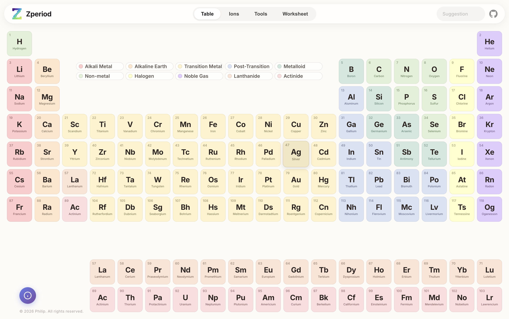
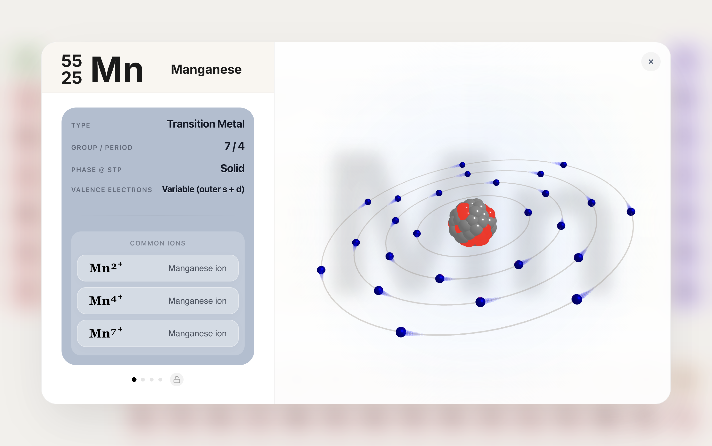
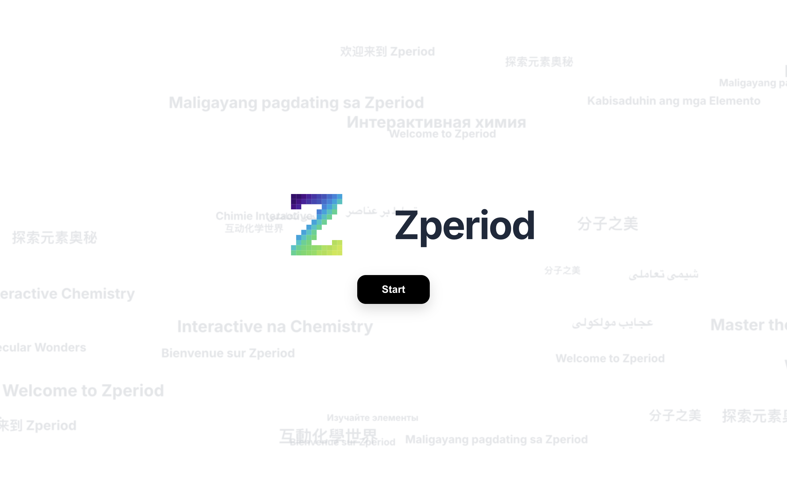
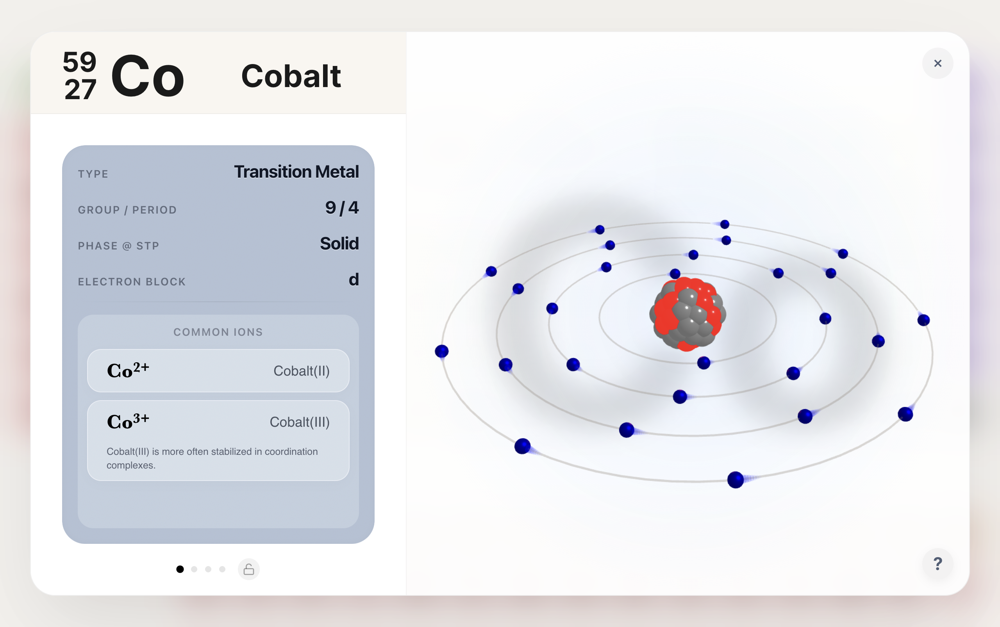
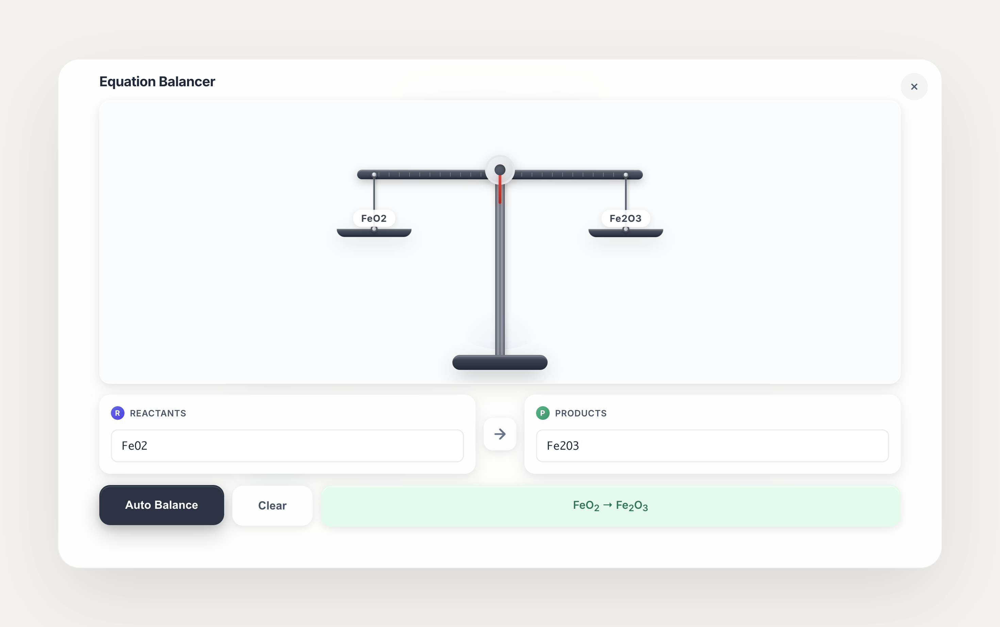
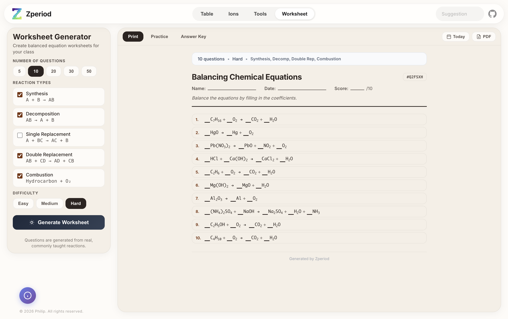

# Zperiod — SmartLab 3D sub-app (vendored)

This folder is a vendored copy of **[Zperiod](https://github.com/Zhilips/Zperiod)** by Philip (Zhilips),
released under the MIT License (see `LICENSE`). It is framed by SmartLab 3D at
`/chemistry/periodic-table`, `/chemistry/ions`, `/chemistry/chem-tools` and `/chemistry/worksheet`.

Changes made for SmartLab (everything else is upstream `main`, commit 595a536):

- Vite `base` is `/oracle/vlab/zperiod/`; classic scripts (`three.min.js`, `matter.min.js`,
  `ion-animations.js`, `worksheet-generator.js`) moved to `public/` and loaded via `import.meta.env.BASE_URL`.
- Embed mode (root carries the `embed` class) hides the Zperiod brand/version/page pills, about button, welcome/changelog modals and the
  onboarding tour (`css/embed.css`, `js/modules/embedController.js`); `?page=` / `#page` deep-link a
  section and `postMessage({type:"zperiod:page"})` switches it from the host.
- New Uzbek locale `uz` (`js/data/locales/ui/uz.js`, element names `js/data/locales/uz.js`, ion names
  `js/data/locales/ions/uz.js`); element/ion descriptions fall back to the `ru` locale. `uz` is the default
  when nothing is saved, `?lang=` overrides and persists.
- Removed: Google Analytics / Microsoft Clarity tags, zperiod.app SEO/OG tags, the mobile "desktop only"
  landing and rotate-device overlays, the Discord suggestion webhook, the Buy-me-a-coffee card,
  `.continue`, `.codex-checks`, Python helper scripts, Playwright smoke tests, `ionsData copy.js`, `*.tmp`.
- driver.js (tutorials) is bundled from npm instead of the jsDelivr CDN.
- The empirical/molecular formula tool card is restored on the Tools page (upstream kept the tool but
  dropped its card); the grid is 3 columns wide, 1 column on phones.

- Native mount (no iframe): `src/embed.js` exports `mountZperiod(container, { page, lang, searchSlot,
  onPageChange })`, `showPage`, `unmountZperiod`, `openElement(symbol)`; `src/elements.js` (element data
  adapter with Uzbek names) and `src/chem.js` (balancer + molar mass) are consumed by SmartLab. `src/app.html`
  is the markup template, `src/tableScale.js` the host-sized table auto-scale, `src/theme.css` the SmartLab
  dark theme. All stylesheets are scoped under `.zp-root` at build time by `src/scopeCss.js` (Vite plugin).
  Classic scripts became ES modules (`js/ionAnimations.js`, `js/worksheetGenerator.js`); three.js comes from
  SmartLab's dependency; `static/matter.min.js` is copied to `client/public/zperiod-static/`.

Build: part of SmartLab's build (`cd client && npx vite build`, alias `@zperiod` → `client/zperiod/src`).
`npm install` here only provides driver.js (and eslint for `npm run lint`).

---

# 🧪 Zperiod

<div align="center">

**An Interactive Periodic Table for Chemistry Students**

[](https://developer.mozilla.org/en-US/docs/Web/JavaScript)
[](https://www.w3.org/Style/CSS/)
[](https://developer.mozilla.org/en-US/docs/Web/HTML)

*Master Chemistry. Visually & Instantly.*

</div>

---

> [!NOTE]
> This repository contains the open-source legacy version of Zperiod. The current product is available at [zperiod.app](https://zperiod.app) and may differ significantly from this codebase.

---

## ✨ Features

### 🔬 Interactive Periodic Table
- **118 Elements** with detailed information
- Click any element to view comprehensive data
- Smooth 3D atom visualization with electron shells
- Category-based color coding (Alkali Metal, Noble Gas, etc.)

### ⚡ Ion Engine
- **Monatomic & Polyatomic Ions** database
- Custom animations for each ion's properties
- Visual hints for flame tests, solubility, and more
- Real-time charge calculations

### 🛠️ Chemistry Tools
| Tool | Description | Grade Level |
|------|-------------|-------------|
| **Equation Balancer** | Balance chemical equations with step-by-step solutions | 9-12 |
| **Molar Mass Calculator** | Calculate molar mass with element breakdown | 10-11 |
| **Empirical & Molecular Formula** | Derive formulas from mass data | 10-11 |
| **Solubility Table** | Quick reference for ionic compounds | 9-12 |

---

## 🆕 Recent Updates (April 2026)

- Mobile-first landing refreshed with softer background motion text stream.
- Mobile landing no longer triggers desktop onboarding/welcome flow.
- Element modal export/download button was removed.
- Custom mobile assets were organized into the `images/` folder:
	- `images/mobile-bg-1.png`
	- `images/mobile-atom-2.png`

### 📝 Worksheet Generator
- Generate balanced equation practice problems
- Multiple reaction types (Synthesis, Decomposition, Combustion, etc.)
- Adjustable difficulty levels
- Print-ready PDF export

### ⌨️ Keyboard Navigation
- **Arrow Keys** (← →) - Navigate between info slides
- **Space Bar** - Next slide
- Fully accessible modal navigation

---

## 🚀 Quick Start

### Local Development
```bash
# Clone the repository
git clone https://github.com/YOUR_USERNAME/zperiod.git

# Navigate to project directory
cd zperiod

# Install dependencies
npm install

# Start dev server (with hot reload)
npm run dev
```

### Quality Checks
```bash
# Lint + syntax check + production build
npm run check
```

### Production Build
```bash
# Build static files to dist/
npm run build

# Preview production build locally
npm run preview
```

---

## 📁 Project Structure

```
zperiod/
├── .github/workflows/ci.yml # CI pipeline
├── package.json            # Vite scripts and dependencies
├── index.html              # Main HTML file
├── script.js               # Main JavaScript logic
├── three.min.js            # Legacy local Three.js copy
├── logo.svg                # Project logo
├── public/                 # Static files copied directly by Vite
├── css/
│   ├── base.css            # Design tokens, layout, navigation
│   ├── grid.css            # Periodic table grid
│   ├── modal.css           # Element detail modals
│   ├── tools.css           # Chemistry tools styles
│   ├── ions.css            # Ion engine styles
│   ├── ion-animations.css  # Ion-specific animations
│   ├── mobile-landing.css  # Mobile landing page
│   └── worksheet-styles.css
├── js/
│   ├── ion-animations.js   # Ion animation logic
│   ├── worksheet-generator.js
│   ├── data/
│   │   ├── elementsData.js # Element database
│   │   └── ionsData.js     # Ion database
│   └── modules/
│       ├── chemistryTools.js
│       ├── ionsController.js
│       ├── threeRenderer.js
│       └── uiController.js
├── images/                 # Preview screenshots
└── README.md
```

---

## 🎨 Design Philosophy

Zperiod follows modern design principles:

- **Minimal & Clean** - Inspired by Apple's design language
- **Glassmorphism** - Subtle frosted glass effects
- **Responsive** - Works on all screen sizes
- **Dark/Light Friendly** - Neutral color palette
- **Micro-animations** - Smooth, delightful interactions

---

## 🎓 Target Audience

- **Grade 9-12 Chemistry Students**
- **AP Chemistry / IB Chemistry**
- **Teachers** looking for classroom tools
- **Anyone** interested in chemistry visualization

---

## 📸 Screenshots

<details>
<summary>Click to expand screenshots</summary>

### Periodic Table View
*The main interactive periodic table with category legends*



### Element Detail Modal
*Comprehensive element information with 3D atom model*



### Mobile Welcome Stream Style
*Subtle multilingual background stream style used on the mobile-first landing experience*



### Mobile Atom Card Visual
*Custom Atom Models card visual used in the mobile landing feature preview*



### Equation Balancer
*Balance chemical equations with real-time scale visualization*



### Worksheet Generator
*Generate print-ready balanced equation worksheets*



</details>

---

## 🛡️ License

This project is open source under the [MIT License](LICENSE).

---

## 🙏 Acknowledgments

- **Three.js** - 3D graphics library
- **Google Fonts (Inter)** - Typography
- **The Chemistry Community** - For inspiration

---

<div align="center">

**Built with ❤️ and lots of ☕**

*Stop memorizing — start visualizing.*

[](https://buymeacoffee.com/Zperiod)

</div>
